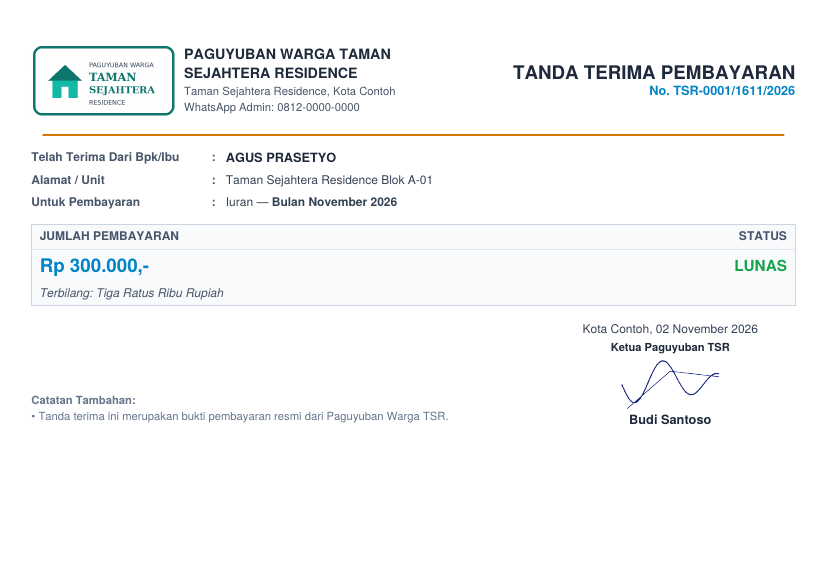

# Paguyuban Billing Automation

Script Python untuk membuat surat tagihan iuran dan kwitansi paguyuban warga perumahan dalam bentuk PDF, langsung dari file Excel. Dulu semua ini dikerjakan satu per satu pakai mail merge Word. Sekarang cukup isi spreadsheet, lalu jalankan satu perintah.

<p align="center">
  
  
</p>

> Semua data di repo ini fiktif: nama warga, blok, rekening, nomor telepon, logo, dan tanda tangan.

## Fitur

- Membuat PDF surat tagihan dan kwitansi (A5 landscape) lengkap dengan logo, tanda tangan, dan status bayar.
- Mengisi terbilang otomatis kalau kolomnya kosong, misalnya "Enam Ratus Ribu Rupiah".
- Menangani tagihan beberapa bulan sekaligus, termasuk catatan rinciannya.
- Merapikan data warga jadi CSV atau Google Sheet untuk dihubungkan ke Looker Studio.
- Semua isian khas paguyuban (nama, rekening, ketua, batas bayar) ada di `config.yaml`, jadi tidak perlu mengubah kode.

## Cara pakai

```bash
git clone https://github.com/andhikasepti/paguyuban-billing-automation.git
cd paguyuban-billing-automation

python -m venv .venv
source .venv/bin/activate        # Windows: .venv\Scripts\activate
pip install -r requirements.txt

python -m paguyuban_billing all
```

Perintah di atas memakai `config.example.yaml` dan data contoh. PDF-nya muncul di folder `output/tagihan/` dan `output/kwitansi/`. Contoh hasil jadi ada di `examples/output/`.

Perintah lainnya:

| Perintah | Fungsi |
| --- | --- |
| `python -m paguyuban_billing invoices` | Buat surat tagihan saja |
| `python -m paguyuban_billing receipts` | Buat kwitansi saja |
| `python -m paguyuban_billing clean` | Rapikan data warga ke `output/data_looker_ready.csv` |
| `python -m paguyuban_billing clean --push-gsheet` | Sama seperti di atas, lalu kirim ke Google Sheet (opsional) |

Tambahkan `-c config.yaml` untuk memilih file konfigurasi, atau `-o folder` untuk mengganti folder output.

## Mengganti data contoh

1. Salin konfigurasi: `cp config.example.yaml config.yaml` (file ini sudah masuk `.gitignore`).
2. Isi identitas paguyuban, rekening, nama ketua, serta lokasi file logo dan tanda tangan.
3. Siapkan Excel dengan kolom seperti di bawah, lalu arahkan `data.excel_path` ke file itu.

Sheet tagihan (kolom bertanda * wajib):

| Kolom | Keterangan |
| --- | --- |
| No Tagihan * | Nomor dokumen |
| Blok * | Contoh: `A-01` |
| Nama Pemilik * | |
| Jangka Pembayaran * | Contoh: `November 2026` |
| Iuran | Iuran per bulan |
| Jumlah Bulan | Default 1. Kalau lebih dari 1, muncul catatan rincian |
| Total | Kalau kosong, dihitung dari Iuran x Jumlah Bulan |
| Catatan | Ikut tampil di bagian catatan |

Sheet kwitansi:

| Kolom | Keterangan |
| --- | --- |
| No Pembayaran * | Nomor kwitansi |
| Blok *, Nama Pemilik *, Nominal * | |
| Tanggal Pembayaran | Format tanggal Excel atau teks |
| Terbilang | Kalau kosong, dihitung otomatis |
| Alamat Pemilik | Kalau kosong, memakai `organization.address_prefix` + blok |
| Jenis Pembayaran, Jangka Pembayaran | Ada nilai default di konfigurasi |
| Catatan Khusus | Tampil tebal di bagian catatan |

Contoh lengkapnya ada di `data/sample_data.xlsx`.

### Data dari link atau Google Sheets

Simpan link di environment variable supaya tidak ikut ter-commit:

```bash
export DATA_URL="https://www.dropbox.com/....xlsx?dl=0"
python -m paguyuban_billing receipts
```

Untuk Google Sheets:

```bash
pip install -r requirements-gsheets.txt
export GOOGLE_SHEET_URL="https://docs.google.com/spreadsheets/d/.../edit"
export GOOGLE_APPLICATION_CREDENTIALS="/path/ke/service-account.json"
python -m paguyuban_billing clean --push-gsheet
```

Bagikan sheet-nya ke email service account dengan akses Editor, lalu sambungkan tab `Data_Looker_Ready` ke Looker Studio. Bagian ini butuh kredensial asli, jadi tidak ikut diuji di unit test.

## Struktur folder

```
paguyuban_billing/   kode utama (cli, config, data_loader, cleaning, invoice, receipt, layout, dll.)
scripts/             pembuat data dan aset contoh
tests/               unit test
data/                data contoh (sample_data.xlsx)
assets/              logo dan tanda tangan placeholder
examples/output/     contoh hasil PDF
```

Untuk menjalankan test: `pip install -r requirements-dev.txt`, lalu `pytest`.

## Privasi

Dokumen iuran berisi nama, alamat, dan nomor rekening warga. Jadi jangan commit data asli, `config.yaml`, kredensial, atau folder `output/`. Semuanya sudah ada di `.gitignore`. Logo dan tanda tangan di repo ini hanya placeholder. Pakai aset resmi hanya di komputer sendiri.

## Pengembangan berikutnya

- [ ] Kirim PDF lewat WhatsApp atau email
- [ ] Tampilan web sederhana untuk pengurus yang tidak biasa pakai terminal
- [ ] Cocokkan otomatis dengan data mutasi rekening
- [ ] Dockerfile

## Lisensi

[MIT](LICENSE)
