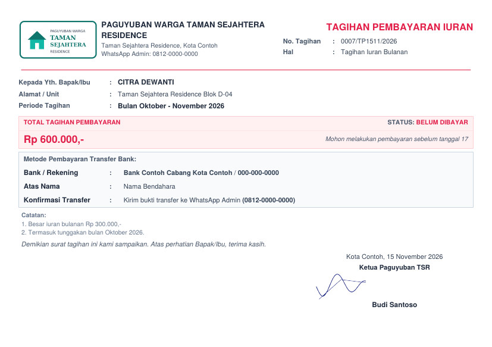
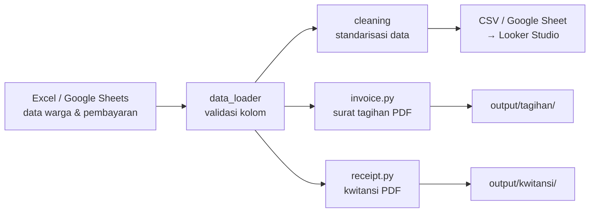

# Paguyuban Billing Automation

> 🇬🇧 *Python pipeline that turns a resident spreadsheet into print-ready PDF invoices and payment receipts for a housing-community association — replacing a manual Word mail-merge workflow.*

Otomasi pembuatan **surat tagihan iuran** dan **kwitansi (tanda terima pembayaran)** untuk paguyuban warga perumahan. Sebelumnya dikerjakan lewat *mail merge* Word satu per satu; sekarang cukup mengisi spreadsheet lalu menjalankan satu perintah.

<p align="center">
  
  
</p>

> ⚠️ **Semua data dalam repo ini fiktif** (nama warga, blok, rekening, nomor telepon, logo, dan tanda tangan). Lihat bagian [Privasi & keamanan](#privasi--keamanan).

## Fitur

- 📄 **PDF tagihan & kwitansi** ukuran A5 landscape, lengkap dengan logo, tanda tangan, nomor dokumen, dan status.
- 🔢 **Terbilang otomatis** ("Enam Ratus Ribu Rupiah") jika kolomnya dikosongkan di spreadsheet.
- 🧮 **Tagihan multi-bulan**: catatan tunggakan dan besar iuran bulanan muncul otomatis.
- 🧹 **Tahap cleaning** data warga → CSV / Google Sheet yang siap dihubungkan ke **Looker Studio**.
- ⚙️ **Semua nilai spesifik paguyuban ada di `config.yaml`**, tidak di dalam kode, sehingga bisa dipakai paguyuban lain.
- 🛡️ Validasi kolom, pesan error yang jelas, dan penanganan karakter khusus (mis. `&` pada nama) agar PDF tidak rusak.
- ✅ Unit test + CI GitHub Actions.

## Alur kerja



## Mulai cepat

```bash
git clone https://github.com/<username>/paguyuban-billing-automation.git
cd paguyuban-billing-automation

python -m venv .venv && source .venv/bin/activate     # Windows: .venv\Scripts\activate
pip install -r requirements.txt

python -m paguyuban_billing all                       # memakai config.example.yaml + data dummy
```

Hasil ada di folder `output/`:

```
output/
├── tagihan/    Tagihan_C-03_November_2026.pdf, ...
└── kwitansi/   Kwitansi_A-01_November_2026.pdf, ...
```

Contoh hasil siap lihat tersedia di [`examples/output/`](examples/output).

### Perintah

| Perintah | Fungsi |
|---|---|
| `python -m paguyuban_billing invoices` | Buat semua surat tagihan |
| `python -m paguyuban_billing receipts` | Buat semua kwitansi |
| `python -m paguyuban_billing all` | Tagihan + kwitansi |
| `python -m paguyuban_billing clean` | Rapikan data warga → `output/data_looker_ready.csv` |
| `python -m paguyuban_billing clean --push-gsheet` | Sama, lalu tulis ke tab Google Sheet (opsional) |

Opsi umum: `-c path/config.yaml` untuk memilih konfigurasi, `-o folder` untuk folder output.

## Memakai data sendiri

1. Salin konfigurasi: `cp config.example.yaml config.yaml` (file ini sudah di-`.gitignore`).
2. Isi identitas paguyuban, rekening, nama ketua, serta path logo & tanda tangan.
3. Siapkan file Excel dengan format berikut, lalu arahkan `data.excel_path` ke file tersebut.

**Sheet tagihan** (`data.invoice_sheet`)

| Kolom | Wajib | Keterangan |
|---|:--:|---|
| `No Tagihan` | ✅ | Nomor dokumen |
| `Blok` | ✅ | Mis. `A-01` |
| `Nama Pemilik` | ✅ | |
| `Jangka Pembayaran` | ✅ | Mis. `November 2026` |
| `Iuran` | | Iuran per bulan |
| `Jumlah Bulan` | | Default 1; jika > 1 muncul catatan rincian |
| `Total` | | Jika kosong dihitung `Iuran × Jumlah Bulan` |
| `Catatan` (atau `Keterangan`, `Detail`, ...) | | Tampil di bagian catatan |

**Sheet kwitansi** (`data.receipt_sheet`)

| Kolom | Wajib | Keterangan |
|---|:--:|---|
| `No Pembayaran` | ✅ | Nomor kwitansi |
| `Blok`, `Nama Pemilik`, `Nominal` | ✅ | |
| `Tanggal Pembayaran` | | Sel tanggal Excel atau teks |
| `Terbilang` | | Jika kosong dihitung otomatis |
| `Alamat Pemilik` | | Jika kosong memakai `organization.address_prefix` + blok |
| `Jenis Pembayaran`, `Jangka Pembayaran` | | Ada nilai default di konfigurasi |
| `Catatan Khusus` | | Tampil tebal di bagian catatan |

Lihat [`data/sample_data.xlsx`](data/sample_data.xlsx) untuk contoh lengkap.

### Sumber data dari link

Agar link tidak tersimpan di repo, gunakan environment variable:

```bash
export DATA_URL="https://www.dropbox.com/....xlsx?dl=0"   # otomatis diubah ke dl=1
python -m paguyuban_billing receipts
```

### Integrasi Google Sheets / Looker Studio (opsional)

```bash
pip install -r requirements-gsheets.txt
export GOOGLE_SHEET_URL="https://docs.google.com/spreadsheets/d/.../edit"
export GOOGLE_APPLICATION_CREDENTIALS="/path/ke/service-account.json"   # JANGAN di-commit
python -m paguyuban_billing clean --push-gsheet
```

Bagikan Google Sheet ke email service account (akses *Editor*), lalu hubungkan tab `Data_Looker_Ready` ke Looker Studio. Jalur ini membutuhkan kredensial sungguhan sehingga tidak tercakup unit test.

## Struktur proyek

```
paguyuban-billing-automation/
├── paguyuban_billing/
│   ├── cli.py           # antarmuka command line
│   ├── config.py        # pemuatan & validasi config.yaml
│   ├── data_loader.py   # baca Excel/URL, validasi kolom → objek data
│   ├── cleaning.py      # cleaning data warga + integrasi Google Sheets
│   ├── generator.py     # proses batch & penamaan file
│   ├── invoice.py       # layout surat tagihan
│   ├── receipt.py       # layout kwitansi
│   ├── layout.py        # tema, style, dan komponen PDF bersama
│   ├── terbilang.py     # angka → teks bahasa Indonesia
│   └── formatting.py    # rupiah, tanggal, nama file, escape XML
├── scripts/make_sample_data.py   # membuat data dummy & aset placeholder
├── tests/                        # unit test + smoke test end-to-end
├── data/sample_data.xlsx         # data dummy
├── assets/                       # logo & tanda tangan placeholder
├── examples/output/              # contoh hasil PDF
└── config.example.yaml
```

## Pengujian

```bash
pip install -r requirements-dev.txt
pytest
```

Cakupan: konversi terbilang, parsing rupiah & tanggal, cleaning, pembacaan data, serta pembuatan PDF end-to-end.

Untuk membuat ulang data dummy: `python scripts/make_sample_data.py`.

## Privasi & keamanan

Dokumen iuran memuat data pribadi (nama, alamat, nomor rekening, nomor telepon). Karena itu:

- Jangan commit file data asli, `config.yaml`, kredensial, maupun folder `output/` — semuanya sudah ada di `.gitignore`.
- Simpan link data dan URL Google Sheet di environment variable, bukan di kode atau konfigurasi yang di-commit.
- Link berbagi (Dropbox/Google) yang pernah tersebar sebaiknya dicabut dan dibuat ulang.
- Logo dan tanda tangan di repo ini hanya placeholder. Gunakan aset resmi hanya di mesin lokal Anda.

## Perubahan dari versi notebook

Proyek ini dimulai sebagai notebook Colab satu file. Perbaikan utama saat dirapikan:

- Konfigurasi (nama, rekening, ketua, tanggal, batas bayar) dipindah dari kode ke `config.yaml`.
- Dua blok kode PDF yang berbagi nama variabel global dipisah menjadi modul dengan tema masing-masing.
- Sel tanggal Excel sebelumnya akan tercetak `2026-11-16 00:00:00`; kini diformat `16 November 2026`.
- Pembersihan tarif berbasis regex mengubah `300000.0` menjadi `3000000`; kini nilai numerik ditangani terpisah.
- Terbilang dihitung otomatis, dan `Total` dihitung bila rumus Excel belum terhitung.
- Nama dengan karakter `&` atau `<` tidak lagi merusak PDF; nama file duplikat tidak saling menimpa.
- Kolom sumber dipilih berdasarkan **nama**, bukan nomor urut kolom, sehingga tahan terhadap perubahan susunan sheet.

## Rencana pengembangan

- [ ] Kirim PDF otomatis lewat WhatsApp / email
- [ ] Antarmuka web sederhana (Streamlit) untuk pengurus non-teknis
- [ ] Rekonsiliasi otomatis: tandai warga yang sudah/belum membayar dari data mutasi
- [ ] Dockerfile

## Lisensi

[MIT](LICENSE)
